<p align="center"><sub><b>ANNALS OF TECHNOLOGY</b></sub></p>

<h1 align="center">Taking the Machine Apart</h1>

<p align="center"><i>Eight notebooks build machine learning by hand, from a failing bearing<br>to a working GPT-2. Here is the story they tell, with the numbers they produce.</i></p>

<p align="center">By Rajat Sainju</p>

<p align="center">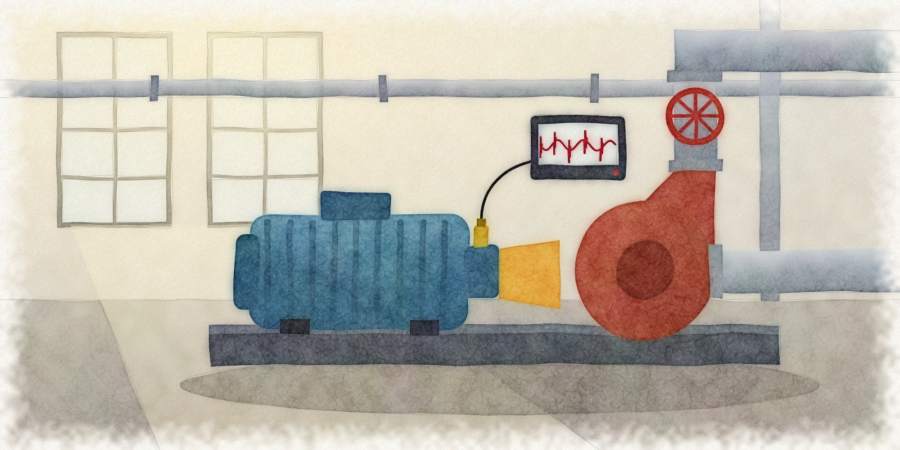</p>
<p align="center"><sub><i>A motor, a pump, and an accelerometer listening to both.</i></sub></p>

---

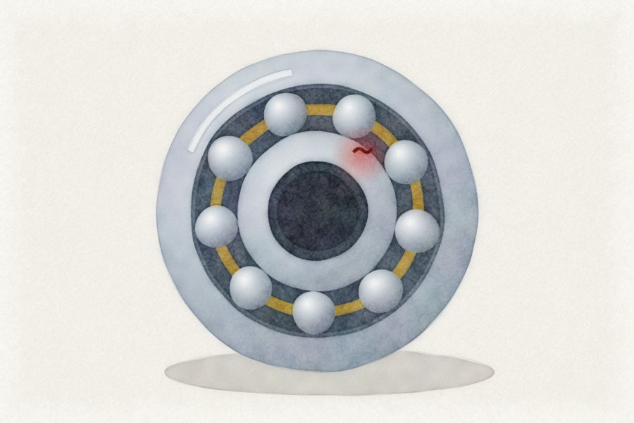

**SOMEWHERE IN A PUMP ROOM**, a bearing has begun to fail. Nobody can hear it yet. The motor hums at the pitch it has held for years. But a small flaw has opened on the inner race, and each time a ball rolls over it the shaft gives a short ring, about a hundred and fifty-six times a second. An accelerometer bolted to the casing records every one. The question that opens this tutorial, and in a sense the whole field, is how a machine might notice what the people in the room have not.

The first notebook answers by building the problem from nothing. A healthy shaft is four harmonics of 30 Hz and some noise. A faulty one adds a sharp strike every 6.4 milliseconds that rings at 3,500 Hz and dies away. Then the notebook does what an engineer with a stethoscope would do, and reduces each half-second to five numbers. Kurtosis says how spiky a signal is. Crest factor compares the tallest peak with the typical one.

<br clear="right">

<picture>
  <source media="(prefers-color-scheme: dark)" srcset="docs/img/chart-windows-dark.png">
  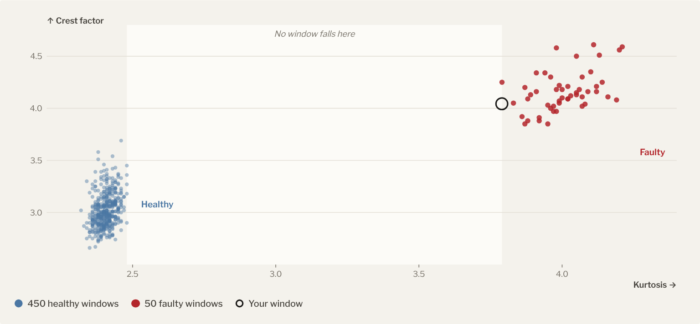
</picture>
<p><sub><b>Every window, by two numbers.</b> All 500 windows from notebook 0, rerun with its seed. Healthy kurtosis runs from 2.32 to 2.48; faulty from 3.79 to 4.21. Kurtosis alone separates them all.</sub></p>

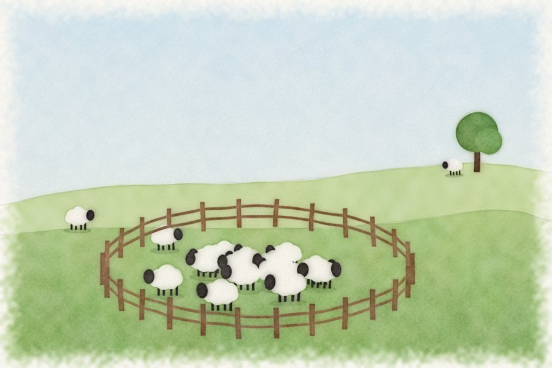

Only then do the algorithms arrive, and none of them is told which windows are faulty. A One-Class SVM draws a fence around normal. An Isolation Forest counts how many random cuts it takes to trap a point; the strange ones are easy to trap. A Local Outlier Factor compares each point with its neighbors and flags the ones that live alone.

The results are not close. The forest catches 46 of the 50 faults and raises 4 false alarms. The fence catches 27. The neighbors catch 11. The faulty windows are not scattered loners; they form a small, tight crowd of their own, and a tight crowd looks perfectly normal to a test that compares each point only with its neighbors.

<br clear="left">

<picture>
  <source media="(prefers-color-scheme: dark)" srcset="docs/img/chart-detectors-dark.png">
  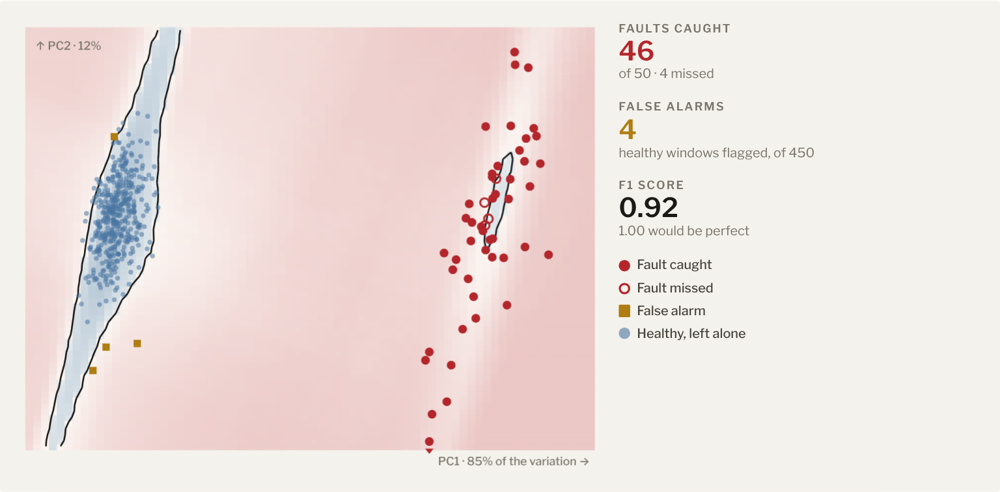
</picture>
<p><sub><b>Where the forest draws the line.</b> The five features flattened to two with PCA. Shading is the Isolation Forest's score; the dark line is its boundary. F1 0.92, against 0.54 for the fence and 0.23 for the neighbors.</sub></p>

Most introductions to machine learning begin with a library call. This one begins with a suspicion: that a model you cannot take apart is a model you do not understand. The notebooks are meant to be read from top to bottom, like chapters, and each one builds the thing it describes before it uses it.

<p align="center">◆</p>

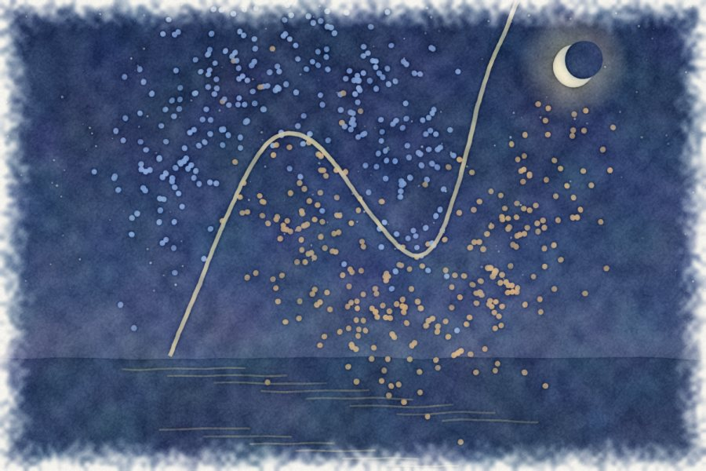

The purest example is the sixth notebook, which builds a neural network with nothing but NumPy. There is no PyTorch here, and no Keras. The data are two interlocking crescents, the kind no straight line can separate. The notebook writes sigmoid, tanh, and ReLU by hand, along with their derivatives, sets the starting weights with Xavier's rule, and trains by backpropagation, which turns out to be the chain rule applied with the patience of a bookkeeper.

In the notebook's own run, the 2-16-8-1 network reaches 92.5 percent on the test points after 2,000 epochs. A bolder learning rate of 0.2 passes 90 percent by epoch 215. A timid 0.001 never gets past 85 percent, about what a straight line can do.

<br clear="right">

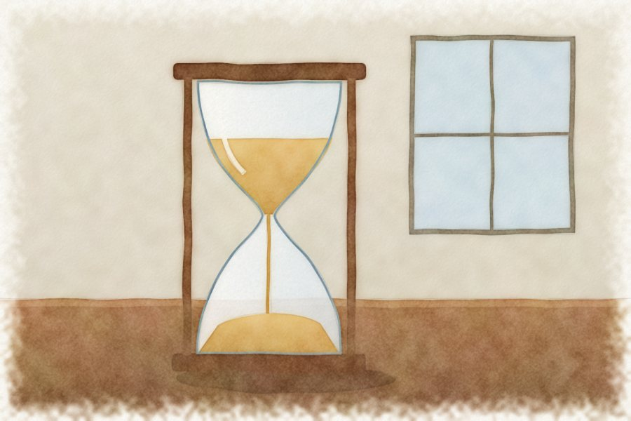

The fifth notebook returns to the pump room with that new tool. An autoencoder squeezes each window's five numbers through a bottleneck of two, then tries to rebuild all five. It trains only on healthy windows, so it learns to rebuild healthy and nothing else. Shown a faulty window, it stumbles, and the size of the stumble becomes the alarm.

The network ranked the windows perfectly: the worst healthy window scored 0.054, and the mildest fault scored 6.7, more than a hundred times higher. Yet the notebook's rule, which flags anything above the 90th percentile of healthy errors, raised 45 false alarms. The model was right. The threshold was timid.

<br clear="left">

<picture>
  <source media="(prefers-color-scheme: dark)" srcset="docs/img/chart-threshold-dark.png">
  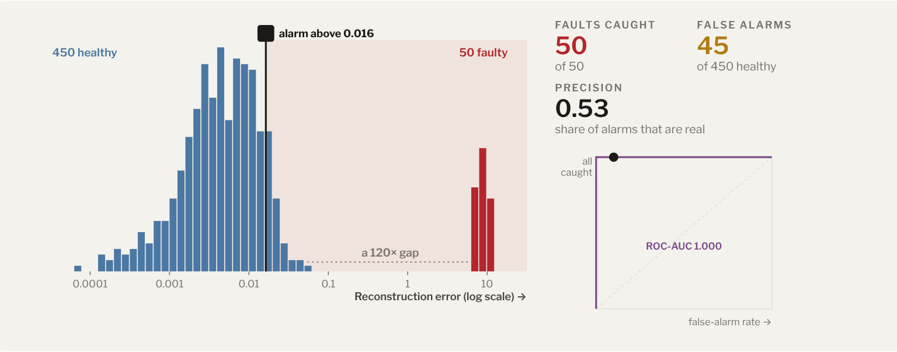
</picture>
<p><sub><b>The timid threshold.</b> Reconstruction error for all 500 windows, from a rerun of notebook 5. Every fault is caught, but so are 45 healthy windows. Any threshold in the 120-fold gap would catch every fault and nothing else.</sub></p>

<picture>
  <source media="(prefers-color-scheme: dark)" srcset="docs/img/chart-scorecard-dark.png">
  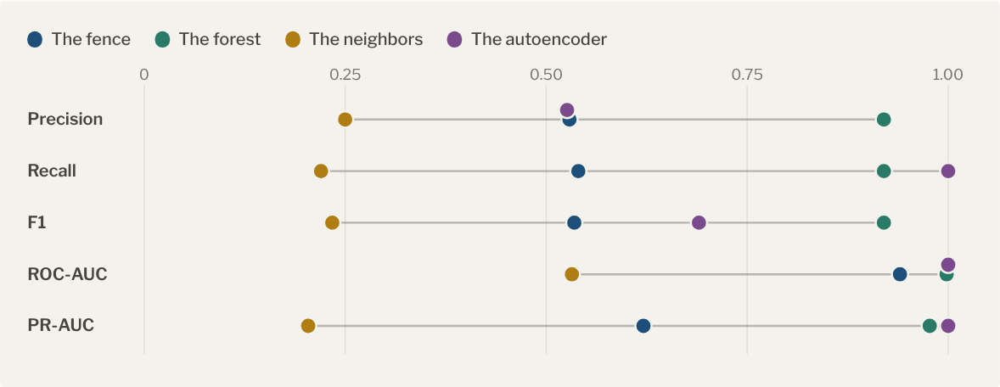
</picture>
<p><sub><b>The scorecard.</b> Notebook 5's comparison table. The autoencoder ranks best (ROC-AUC 1.000); the forest gives the best yes-or-no answers (F1 0.92).</sub></p>

<p align="center">◆</p>

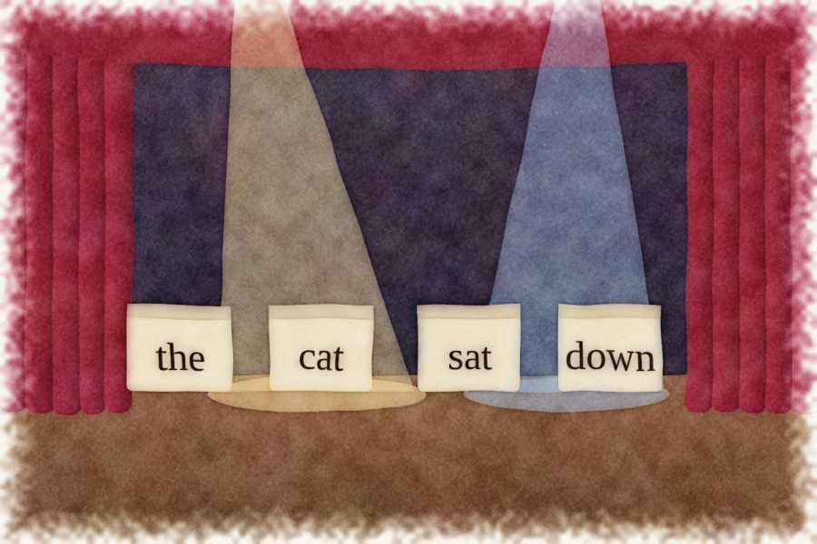

In 2017, eight researchers, most of them at Google, published a paper with a title that sounded like a dare: "Attention Is All You Need." The second notebook takes it at its word. It starts with attention at its smallest, a few vectors deciding how much to look at one another. It shows why the Transformer could read a sentence all at once while the recurrent networks before it had to read word by word. Then it assembles the rest: byte-pair encoding to cut text into tokens, embeddings to turn tokens into vectors, and positional encodings to give the model a sense of order, without which "dog bites man" and "man bites dog" would be the same sentence.

<br clear="right">


The third and fourth notebooks are PyTorch translations of companion notebooks from François Chollet's "Deep Learning with Python," with more pictures and more prying. The third opens a VGG16 network that has seen more than a million photographs and asks what it learned. Its first layers turn out to detect edges and colors. Deeper filters, coaxed into view by gradient ascent, answer to textures and patterns of growing intricacy. Grad-CAM paints a heat map over a photograph of an elephant, showing where the network was looking when it made up its mind.

<br clear="left">


The fourth teaches a small recurrent network to write like Shakespeare, one character at a time, and then to translate English into Spanish. Then it opens a Transformer and starts removing parts: it silences attention heads one by one, reads the model's half-formed guesses with the logit lens, and traces how information flows through the residual stream.

<br clear="right">


The seventh notebook is a short parable about meaning. It asks two models how to catch a computer virus, and offers them five answers: two about computers, one about doctors and hand-washing, one about the flu, and one about a stock that "caught a cold." The fast model reads the question and each answer separately; the slower one reads them side by side. Both put the five answers in the same order, and both rank the doctors above the sentence about antivirus software, which says the right thing in different words. Meaning, it turns out, is still partly a matter of vocabulary.

<br clear="left">

<p align="center">◆</p>


The last folder, `neo-nanogpt`, is the capstone. Following Andrej Karpathy's lecture "Let's reproduce GPT-2," it rebuilds the hundred-and-twenty-four-million-parameter GPT-2 from blank files. It first checks its work by loading OpenAI's released weights, and then begins training its own copy on a million characters of Shakespeare. Along the way it uses the tricks that make modern training fast: fused attention kernels, `torch.compile`, bfloat16 arithmetic, gradient accumulation to reach half-million-token batches, a warmup-then-cosine learning rate, gradient clipping, and training across several GPUs at once.

<br clear="right">

<picture>
  <source media="(prefers-color-scheme: dark)" srcset="docs/img/chart-gpt2-dark.png">
  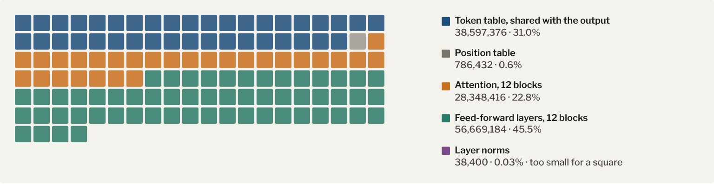
</picture>
<p><sub><b>Where GPT-2 keeps its parameters.</b> Each square is about a million of its 124,439,808 numbers, computed from the configuration in <code>train_gpt2.py</code>. Almost a third is one table of token embeddings, used twice: to read tokens in and to score the next one out.</sub></p>

None of this replaces the libraries. Nobody should hand-write backpropagation for work that matters. But the bearing in the pump room is a good teacher. It suggests an order of operations that applies well beyond pumps: listen first, build the instrument yourself, and trust it only after you have reëxamined every part. ♦

<p><sub><i>Published in the <code>main</code> branch of <code>rajatsainju2025/ml-tutorial</code>, with the headline "Taking the Machine Apart."</i></sub></p>

---

## The particulars

### The notebooks

| # | Notebook | What it builds | Needs |
|---|---|---|---|
| 0 | [`0_svm-iforest`](various_models/0_svm-iforest.ipynb) | Anomaly detection, in depth: One-Class SVM, Isolation Forest, LOF, on simulated bearing vibrations | scikit-learn |
| 1 | [`1_svm-apply`](various_models/1_svm-apply.ipynb) | The same pipeline, shorter and applied: features, two detectors, comparison | scikit-learn |
| 2 | [`2_transformer-tutorial`](various_models/2_transformer-tutorial.ipynb) | The Transformer from attention up: BPE, embeddings, positional encoding | PyTorch |
| 3 | [`3_convnet-interpretability`](various_models/3_convnet-interpretability.ipynb) | Inside VGG16: activations, filter visualization, Grad-CAM, guided backprop, t-SNE | PyTorch, torchvision |
| 4 | [`4_language-models`](various_models/4_language-models.ipynb) | Character-level GRU, Seq2Seq translation, Transformer, attention-head ablation, logit lens | PyTorch, transformers |
| 5 | [`5_neural-network-autoencoder`](various_models/5_neural-network-autoencoder.ipynb) | An autoencoder for anomalies, with ROC/PR curves, permutation importance, model export | PyTorch |
| 6 | [`6_feedforward-nn`](various_models/6_feedforward-nn.ipynb) | A neural network in NumPy only: forward pass, backprop, ablations | NumPy |
| 7 | [`7_word2vec`](various_models/7_word2vec.ipynb) | Bi-encoder vs. cross-encoder on the "virus" test | sentence-transformers |
| — | [`neo-nanogpt/`](neo-nanogpt) | GPT-2 (124M) rebuilt and trained: [`train_gpt2.py`](neo-nanogpt/train_gpt2.py), [`nb_gpt2`](neo-nanogpt/nb_gpt2.ipynb), [`nb_snippets`](neo-nanogpt/nb_snippets.ipynb) | PyTorch, tiktoken, a GPU |

### A reading order

```
Classical ML   0 → 1 → 6 → 5
Deep learning  2 → 3 → 4 → 7 → neo-nanogpt
```

Notebooks 0 and 1 need no deep learning at all.

### Setup

```bash
git clone https://github.com/rajatsainju2025/ml-tutorial.git
cd ml-tutorial
pip install numpy pandas matplotlib seaborn scipy scikit-learn jupyter
pip install torch torchvision          # notebooks 2–5 (see pytorch.org for CUDA or MPS builds)
pip install transformers datasets      # notebook 4
pip install sentence-transformers      # notebook 7
jupyter lab
```

To train GPT-2 (a CUDA GPU is strongly recommended):

```bash
pip install tiktoken transformers
cd neo-nanogpt
python train_gpt2.py                                    # one GPU
torchrun --standalone --nproc_per_node=8 train_gpt2.py  # eight GPUs
```

### Credits

Notebooks 3 and 4 adapt the companion notebooks of François Chollet's
[*Deep Learning with Python*, third edition](https://www.manning.com/books/deep-learning-with-python-third-edition).
`neo-nanogpt` follows Andrej Karpathy's
[build-nanogpt](https://github.com/karpathy/build-nanogpt). The Transformer is from
[Vaswani et al., 2017](https://arxiv.org/abs/1706.03762).

### About the figures

The charts come from rerunning notebooks 0 and 5 with their own seed, and from the
configuration in `train_gpt2.py`; their numbers match the notebooks' saved outputs.
The illustrations were drawn as simple vector scenes and painted with an OpenCV
watercolor filter (uneven washes, pigment pooling at the edges, granulation, a
pencil underdrawing and paper grain). The moons painting plots notebook 6's real
data and a trained network's real decision boundary; the elephant's Grad-CAM glow
is painted, not computed.

### License

MIT
